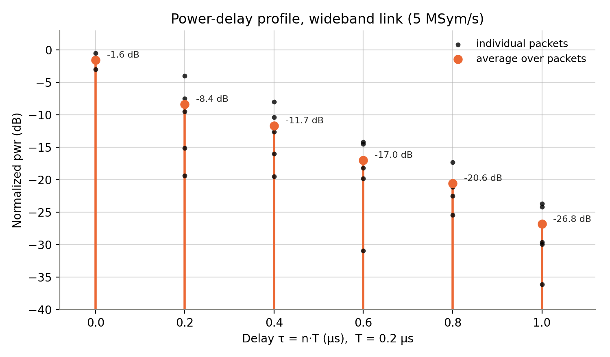

# EE471C Lab 4 — Channel Estimation & Equalization (Report)

## 3.1

**1. What is the symbol rate of your system?**

100K symbols per second

**2. What is the passband bandwidth of your system?**

(1+α)/T where alpha=0.5 so => **150 kHz.**

**3. Based on your observations, describe the impairments imparted to the received constellation. You may need to "auto-scale" the axes of your constellation in `receiver.vi` in order to observe the effects of the narrowband wireless channel.**

The received constellation indicates that the channel acted like a single complex gain h ≈ |h|e^{jφ}: the constellation came out scaled down (we had to auto-scale) and rotated by φ. The points were noisy and smeared rather than in four tight clusters (for QPSK) -- due to the noise and frequency offset.

---

## 3.2

**1. What is the symbol rate of your system?**

5M symbols/s.

**2. What is the passband bandwidth of your system?**

(1+α)/T where alpha=0.5 so => **7.5 MHz**

**3. Based on the data you have collected in this part of the experiment, make a plot of the power-delay profile of the wideband wireless link in lab. Discard any outlying observations that might have been caused by errors in frame detection or noise. Average the power-delay profile over the remaining observations.**

---

## End of Lab Questions

**1. Answer all questions from the lab experiment (i.e., do not re-answer pre-lab questions).**

Answered above

**2. Discuss any problems you might have encountered and how you overcame these obstacles.**

Mainly hardware issues. Loose connection on the RX antenna (temporarily replaced with another team's for the experiment). Loose connection between USB dongle and flashing the SDR from laptop. No issues with the VIs.

**3. In this lab, you observed how your code operates over a narrowband channel and a wideband channel. The following questions will explore the differences between these two channels.**

**(a) What is the symbol period of the narrowband system in Section 3.1?**

1/(100K symbols/s) = 10 µs.

**(b) What is the symbol period of the wideband system in Section 3.2?**

1/(5M symbols/s) = 0.2 µs.

**(c) If the continuous-time channel h(τ) has nonzero support for τ ∈ \[0, 2.5 µsec), then how many nonzero taps will h\[n\], the equivalent discrete-time channel, have in the narrowband and wideband system respectively? In other words, if Tnb and Twb are the symbol periods of the narrowband and wideband systems respectively, find the cardinality (i.e., number of elements) of the set A = {n | h\[n\] ≠ 0} for each system.**

Since h[n] = h(nT), a tap can only be nonzero when 0 ≤ nT < 2.5 µs, i.e. 0 ≤ n < 2.5 µs / T.

- In narrowband system, equivalent DT channel will have one nonzero tap: 2.5 / 10 = 0.25, so only n = 0 → |A| = 1.
- In wideband system, equivalent DT channel will have thirteen nonzero taps: 2.5 / 0.2 = 12.5, so n = 0, 1, …, 12 → |A| = 13 

**(d) Which of the two systems can "resolve" the channel response h(τ) more accurately?**

The wideband system resolves the response more accurately. With T = 0.2 µs it samples h(τ) 13 times across its 2.5 µs 'span', so the shape of the delay profile shows up in h[n]. 

The narrowband system (T = 10 µs) only gets a single sample, so every path lands into the same/singular tap.
