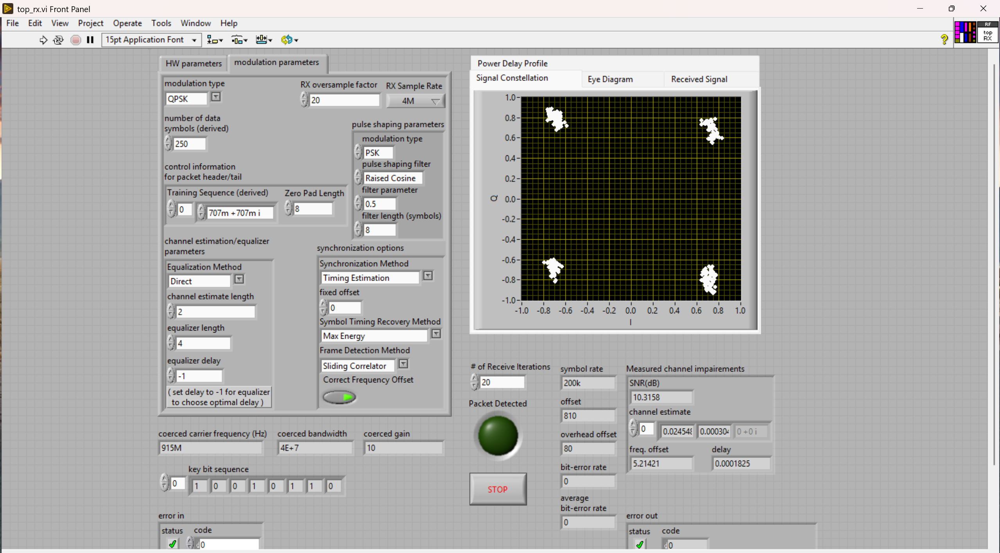
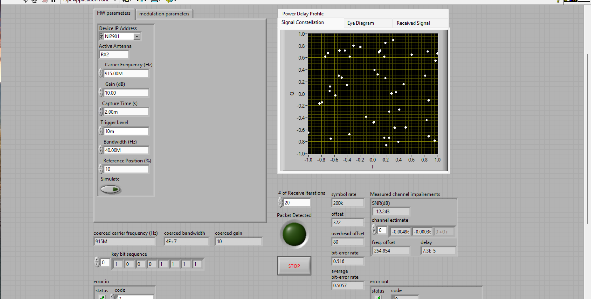
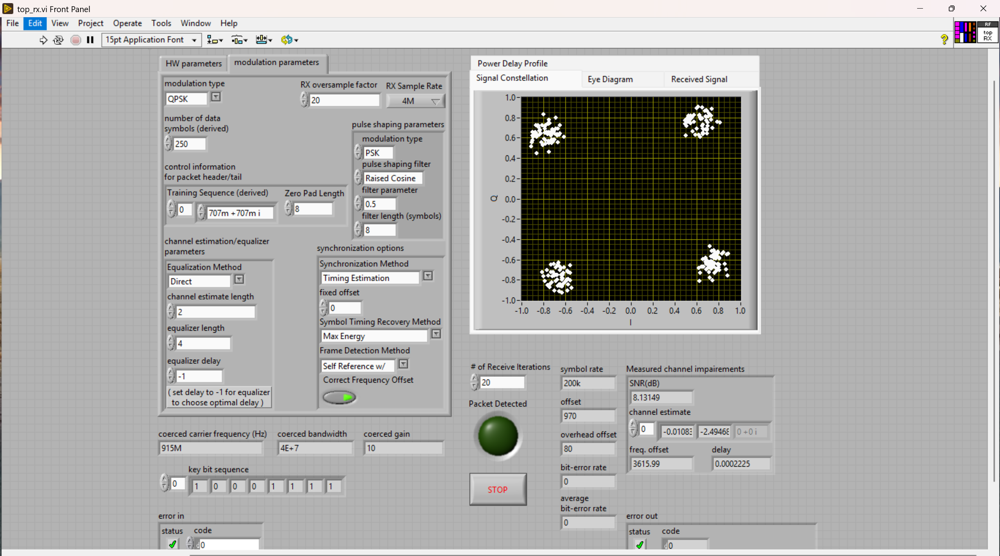

# EE471C Lab 5 — Frame Detection & Frequency Offset Correction (Report)

**System parameters:** TX/RX sample rate = 4 MS/s, oversample factor = 20, so the symbol rate is $1/T = 200$ kHz ($T = 5\,\mu s$). Channel estimate length = 2, equalizer length = 4, capture time = 2 ms, QPSK, Correct Frequency Offset = TRUE, carrier = 915 MHz. The training sequence is four length-11 Barker codes (44 symbols), so Moose uses $N_t = 22$.

**Baseline** (sliding correlator, TX = RX = 915 MHz, no added offset): four tight QPSK clusters, freq. offset = 5.21 Hz, SNR = 10.32 dB, BER = 0, average BER = 0 (20 iterations), frame offset = 810.

---

## 3.1 Correlation Based Frame Detection Under Large Frequency Offsets

**1. Before changing any of the settings, calculate an average value (using five runs or so) of the inherent offset between the transmitter and receiver.**

With TX = RX = 915 MHz, five runs gave estimates of 2.05, 6.99, −2.51, −2.82 and −4.38 Hz. The average is **≈ −0.13 Hz** (std ≈ 4.6 Hz), so the inherent offset is effectively **0 Hz**, and the run-to-run scatter is estimation noise.

This is far below the hundreds of Hz to ~1 kHz you would expect from two independent oscillators at 915 MHz (about 1 ppm). This is because our TX and RX ran off a shared reference clock, so their carriers are derived from the same oscillator. The manual notes that $0.8 f_M$ should be about two orders of magnitude above the inherent offset; in our case it was more than that.

**2. Based on the system parameters, what is the range of frequency offsets that can be estimated by your frequency offset estimation algorithm?**

Moose estimates $\hat{\epsilon}$ from the phase of the correlation between the two training halves, and that phase is unambiguous only while $|2\pi \epsilon N_t| < \pi$. So

$$|f_{\text{offset}}| < f_M = \frac{1}{2 T N_t} = \frac{1}{2 \cdot 5\,\mu s \cdot 22} \approx 4.545 \text{ kHz}$$

The estimable range is about **±4.55 kHz**.

**3. Let $f_M$ be the maximum correctable frequency offset of your system. Modify the carrier frequency of your transmitter so that you will cause an effective offset of $0.80 f_M$ at the receiver. What is the new value of the carrier frequency at your transmitter?**

$0.8 f_M \approx 3636$ Hz. Since the inherent offset is about 0, the RX carrier stays at 915 MHz and the **TX carrier is 915.003636 MHz**. The self-referenced detector later measured 3616 Hz at this setting, which confirms the effective offset.

**4. How does this frequency offset impact the performance of your correlation based frame detector? Describe what happens to the error rate and constellation of your system.**

The correlation detector **no longer finds the start of the frame**. "Packet Detected" still lights, but the detected frame position is wrong. Moose, channel estimation and equalization then all run on the wrong samples:

- The frequency estimate is garbage and unstable, e.g. 254.85 Hz on one run and ~3314 Hz on others, against 3636 Hz applied.
- The channel estimate is about 0 and the SNR is −12.2 dB.
- The BER is 0.516 and the average BER is **0.506**, which is coin-flip guessing.
- The constellation is uniform scatter with no QPSK clusters.

Degradation was already visible at a smaller offset. At +2825 Hz (≈ $0.62 f_M$), the estimate read 2478 ± 50 Hz, about 350 Hz low, because the frame timing was becoming unreliable.

---

## 3.2 Self Referenced Frame Synchronization

We switched the Frame Detection Method on `top_rx.vi` to **"Self Reference w/ Power Normalization"** and kept TX at 915.003636 MHz. The detector locked reliably:

| | Baseline (correlator, no offset) | Correlator @ 0.8 $f_M$ | Self Ref @ 0.8 $f_M$ |
|---|---|---|---|
| Freq. estimate | 5.21 Hz | 254.85 Hz (unstable) | 3615.99 Hz |
| SNR | 10.32 dB | −12.2 dB | 8.13 dB |
| Average BER | 0 | 0.506 | 0 |
| Constellation | 4 tight clusters | uniform scatter | 4 clean clusters |

**Question: Using the simple channel model of Eq. (11), explain why the self referenced frame detector of Eq. (10) works better than the correlation based detector under large frequency offsets.**

The received signal is $y[n] = \alpha e^{j2\pi\epsilon n} t[n-D]$, with unit-magnitude training symbols $|t[k]| = 1$.

**Correlation detector, Eq. (2).** At the correct lag $n = D$:

$$R[D] = \left|\sum_{k=0}^{N-1} t^*[k]\, \alpha e^{j2\pi\epsilon(k+D)} t[k]\right| = |\alpha| \left|\sum_{k=0}^{N-1} e^{j2\pi\epsilon k}\right| = |\alpha| \left|\frac{\sin(\pi \epsilon N)}{\sin(\pi\epsilon)}\right|$$

The offset adds a phase that **rotates term by term inside the sum**, so the terms no longer add coherently. With no offset the peak is $|\alpha| N$. In our case $N = 44$ and $\epsilon = f_{\text{offset}} T = 3636 \cdot 5\,\mu s \approx 0.018$, so $\epsilon N \approx 0.8$ and the peak shrinks to about $|\alpha| \cdot 10.3$, roughly 23% of its ideal value. Correlations with data and noise at the wrong lags then exceed it, and the argmax lands in the wrong place.

**Self-referenced detector, Eq. (10).** This method correlates the received signal with itself, $N_t$ samples later. At $d = D$, periodicity ($t[n + N_t] = t[n]$) gives

$$y[n+D+N_t]\, y^*[n+D] = |\alpha|^2 e^{j2\pi\epsilon (n + D + N_t)} e^{-j2\pi\epsilon (n+D)} |t[n]|^2 = |\alpha|^2 e^{j2\pi\epsilon N_t}$$

The offset now appears as a **constant phase $e^{j2\pi\epsilon N_t}$, the same for every $n$**. All the terms add coherently, and the outer magnitude removes that phase. The numerator becomes $|\alpha|^2 \sum |t[n]|^2$, which matches the power-normalization term, so the metric reaches its maximum of 1 at $d = D$ for any $\epsilon$. The detector output is therefore $D$, independent of the frequency offset, and that same constant phase is what Moose uses to estimate $\epsilon$.

---

## 3.3 Lab Turn In

We showed the instructor three things: the code working with no added offset, the correlation detector failing at $0.8 f_M$, and the self-referenced synchronizer working at the same offset. The instructor signed off.

---

## End of Lab Questions

**1. Answer all questions from the lab experiment.**

Answered above.

**2. Discuss any problems you might have encountered and how you overcame these obstacles.**

At first we read the wrong field on `top_rx`. The `offset` indicator, which sat steady at 810–811, is the **frame offset** (sample index of the detected frame), not the frequency offset. Our first TX carrier for Q3 was computed from that number, which made the results look inconsistent. A small test offset (+1 kHz) left that field unchanged, which exposed the mistake. To find the right indicator, we traced the VI stack from our Moose VI up through `receiver.vi` to `top_rx.vi` and found where the frequency estimate is wired out: the **freq. offset** indicator under "Measured channel impairments". We then took the readings from that indicator and redid Q1 and Q3.

During the pre-lab, the correlator's frame offset also came out too large by the transmitter's zero padding. The raw argmax was 18 for a 10-symbol delay. We fixed it by subtracting the Zero Pad Length from the reported offset.

**3(a). Name three impairments in a real wireless system which impact the accuracy of the correlation based detection method.**

- **Carrier frequency offset.** It rotates the phase across the training sequence and de-coheres the correlation sum, as shown in this lab.
- **Multipath / frequency-selective fading.** The channel convolves with the training, which spreads and shifts the correlation peak (Eq. (5)) so the argmax may not land on the true start.
- **Noise and low SNR.** The noise term $\sum t^*[k] v[n+k]$ can produce false peaks or bury the true one.

Others include sampling/symbol-timing offset, phase noise and interference.

**3(b). Under large frequency offsets, the correlation based detector "breaks". What property of the training sequence breaks down under large frequency offsets?**

Its **autocorrelation property**: a sharp peak at zero lag and low sidelobes elsewhere. With an offset, the received training equals $t[k]e^{j2\pi\epsilon k}$, so the zero-lag correlation becomes $\sum e^{j2\pi\epsilon k}$ instead of $N$. The peak collapses toward the sidelobe and data-correlation level once $\epsilon N$ approaches 1.

**3(c). In the self referenced frame synchronization method, is it still critical that the periodic training sequence have good autocorrelation properties? If so, why?**

It is less critical for locating the peak, but it still matters. From Eq. (11), the metric reaches 1 at $d = D$ for any periodic training, whatever its autocorrelation, because the detector compares the signal with itself rather than with $t[n]$.

Good autocorrelation is still needed in two places:

- **Timing ambiguity.** A sequence with poor autocorrelation, such as all ones, also gives a metric close to 1 at nearby shifts, so the peak becomes a plateau and $D$ is ambiguous. Good autocorrelation within the period makes the metric fall off quickly away from $D$.
- **Downstream processing.** The same training is used for channel estimation, and that estimate is well conditioned only if the training has low off-peak autocorrelation.
