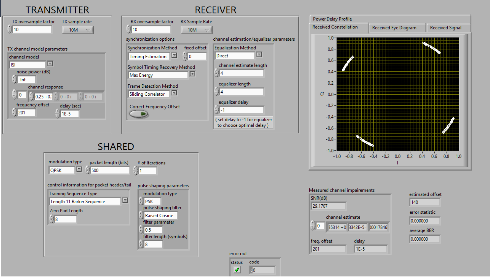

## Prelab Questions

**1. Set up the simulator as for verifying the correlation-based frame detector (Correct Frequency Offset = FALSE), with noise power = 5 dB and an AWGN channel instead of ISI. What happens to the error rate when the delay estimate is off by more than one symbol time ($\hat d \neq d$)?**

If $\hat d$ is off by one or more symbols, the receiver's frame is shifted by whole symbols. The channel estimate is formed from the wrong samples, and each detected symbol is compared against a different transmitted symbol. The decoded bits are effectively 'random' with respect to whatever was sent (truth) so BER jumps to 1/2 regardless of SNR. 

With correct detection, the BER depends only on the noise. In practice, the 44-symbol correlation provides about $10\log_{10}44 \approx 16$ dB of processing gain, so $\hat d$ is accurate even for packets up to 5 dB noise.

**2. Set up the simulator as for verifying Moose, with Correct Frequency Offset = FALSE. What happens to the received constellation if the 201 Hz frequency offset is not corrected?**

- The constellation points smear into arcs (the constellation "spins"). It is rotated about 20 degrees per the calculation below. This is still within the 45 degree QPSK 'decoder' so relatively few errors. 
	- QPSK carries 2 bits/symbol, so a 500-bit packet is 250 data symbols plus 44 training symbols = 294 symbols. That's about $294 \times 0.072° \approx 21°$ of total rotation.
- **Observed:** with the offset uncorrected, the measured SNR fell from ≈ 253 dB (corrected) to **29.17 dB**. Each QPSK point smeared into a short arc with a slight rotation, and Moose still estimated the offset as 201 Hz. Very high offsets would push the points across the quadrant boundaries resulting in incorrect decoding.

**3. Based on the pre-lab system parameters, what range of frequency offsets can Moose estimate/correct?**

- **General:**  $|\epsilon N_t| \le \tfrac12$, which gives $|f_e| \le \dfrac{1}{2TN_t}$. (LATEX-ified with AI help)
- **Specific Case (plugging):** 
	- $T = 1/(10\text{ MHz}/10) = 1\ \mu\text{s}$ and $N_t = 22$, so $|f_e| \le \dfrac{1}{2 \cdot 1\ \mu\text{s} \cdot 22} \approx$ **22.7 kHz**. 
- Range of offsets is roughly **−22.7 kHz to +22.7 kHz**.
