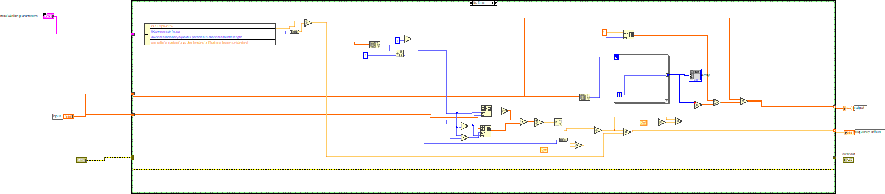
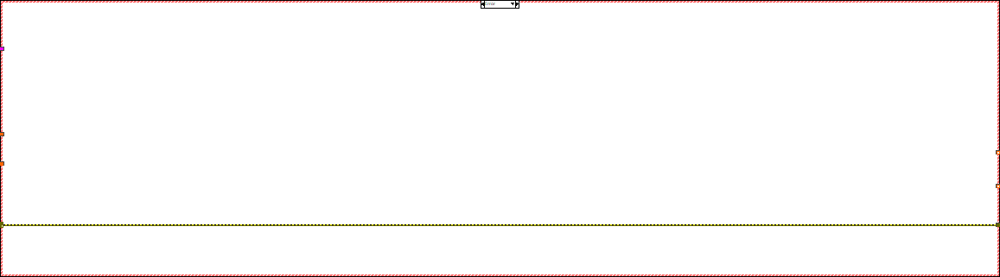
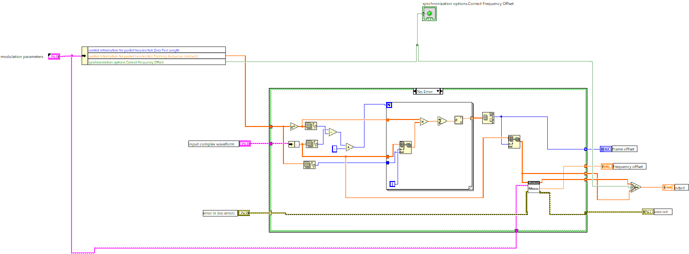
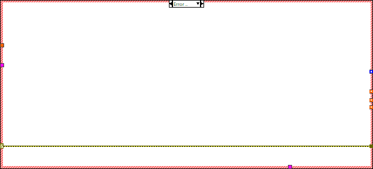

# Lab 5 — Pre-Lab Submission

**Aditya Matam** · EE 471C · Lab 5: Frame Detection & Frequency Offset Correction

## Turn-In

- `adityam_moose.vi`: HTML export `moose/adityam__moose.html`
- `adityam_sliding_correlator.vi`: HTML export `adityam__sliding__correlator.html`
- Answers to the 3 pre-lab questions (below)

## Implementation

### `adityam_moose.vi`

- Unbundles **RX Sample Rate**, **RX oversample factor**, **channel estimate length** and **Training Sequence (derived)** from `modulation parameters`. Symbol rate is $1/T = \text{RX sample rate} / \text{RX oversample factor}$, and $L = \text{channel estimate length} - 1$.
- $N_t = \text{len(Training Sequence)}/2 = 22$. The training is 4 length-11 Barker codes (44 symbols), so it is two identical 22-symbol halves.
- Correlates the two halves: $S = \sum_{l=L}^{N_t-1} y[l+N_t]\,y^*[l]$ (Array Subset ×2, Conjugate, Multiply, Add Array Elements).
- $\hat\epsilon = \angle S / (2\pi N_t)$ (Eq. 8), and $\hat f_e = \hat\epsilon \cdot (1/T)$ (Eq. 9) goes to `frequency offset`.
- Correction $\tilde y[n] = e^{-j2\pi\hat\epsilon n}\,y[n]$ (Eq. 6): a For Loop builds the index array $n$, then Polar To Complex and Multiply. All logic is in the **No Error** case. The **Error** case passes the error through, and the outputs take their defaults.

*Error case:*

### `adityam_sliding_correlator.vi`

- $Y$ comes from the `input complex waveform` cluster. $t$ is the full 44-symbol Training Sequence, conjugated once outside the loop.
- A For Loop over $n = 0, \dots, \text{len}(Y) - \text{len}(t)$ computes $\left|\sum_k t^*[k]\,y[n+k]\right|$ (Eq. 2). The magnitude is not squared, because squaring is monotonic and does not change the argmax.
- $\hat d = \arg\max_n R[n]$ is the max index from Array Max & Min (Eq. 3). It goes to `frame offset`.
- The aligned array $Y[\hat d \dots \text{end}]$ is passed to `adityam_moose.vi`, and Moose's estimate goes to `frequency offset`.
- A Select on `synchronization options.Correct Frequency Offset` outputs either Moose's corrected array or the uncorrected aligned array. The error cluster is chained through Moose.

*Error case:*

## Simulator Verification

Settings: TX/RX oversample factor = 10, TX/RX sample rate = 10 MHz ($1/T = 1$ MHz), packet length = 500 bits, Synchronization Method = Timing Estimation, ISI channel $\{h[0] = 0.35e^{j\pi/4}\}$, channel delay $= 10T_s$. Everything else is left at its default.

| Run | Correct Freq. Offset | Channel freq. offset | Expected | Measured delay | Measured freq. offset | Bit errors / BER |
| --- | --- | --- | --- | --- | --- | --- |
| 1 | FALSE | 0 Hz | delay = 10, 0 bit errors | **[TODO: fill from simulator]** | **[TODO: fill from simulator]** | **[TODO: fill from simulator]** |
| 2 | TRUE | 201 Hz | estimate ≈ 201 Hz, 0 bit errors | **[TODO: fill from simulator]** | **[TODO: fill from simulator]** | **[TODO: fill from simulator]** |
| 3 | FALSE | 201 Hz | estimate still ≈ 201 Hz, but the constellation is not corrected (rotates) | **[TODO: fill from simulator]** | **[TODO: fill from simulator]** | **[TODO: fill from simulator]** |

**Run 1:** frame detection only

**Run 2:** Moose estimates and corrects

**Run 3:** Moose estimates only

## Pre-Lab Questions

**1. Correlation detector setup, Correct Frequency Offset = FALSE, noise power = 5 dB, AWGN channel instead of ISI. What happens to the error rate when $\hat d \neq d$ by more than one symbol time?**

- A whole-symbol error in $\hat d$ shifts the receiver's frame by integer symbols, so the training and data the receiver extracts are misaligned with what was sent.
- The channel estimate is formed from the wrong samples (part padding or data, part training), so the equalizer is wrong as well.
- Each detected data symbol is compared with a different transmitted symbol. The decoded bits are effectively random relative to the truth, so **BER → ~0.5 regardless of SNR**, and the whole packet fails.
- With correct detection, the BER is set only by the 5 dB noise. Frame-timing errors cause a sudden, catastrophic failure, not a gradual one. The 44-symbol correlation gives about $10\log_{10}44 \approx 16$ dB of processing gain, so $\hat d$ stays correct for most packets even at this noise level.
- With the default channel estimate length and equalizer length of 1, the equalizer has no slack to absorb a residual offset. The manual's "equalization takes care of the residual offset" applies only to a longer equalizer.
- Baseline BER with correct $\hat d$: **[TODO: fill from simulator]**
- BER with forced error, e.g. max index ±1 or ±2: **[TODO: fill from simulator]**

**2. Moose verification setup, Correct Frequency Offset = FALSE, 201 Hz offset. What happens to the received constellation?**

- $1/T = 10\text{ MHz}/10 = 1$ MHz, so $\epsilon = f_o T = 201\times10^{-6}$ cycles/symbol. The phase advances $2\pi\epsilon \approx 1.26\times10^{-3}$ rad $\approx 0.072°$ per symbol.
- Assume QPSK (the default modulation type shown on the front panel), so 2 bits/symbol. A 500-bit packet is 250 data symbols plus 44 training symbols ≈ 294 symbols, giving about $294 \times 0.072° \approx 21°$ of total rotation.
- The channel estimate and equalizer remove only a **fixed** phase, fitted over the training, so the residual rotation grows linearly through the data. By the last symbol it is about $(294-22)\times0.072° \approx 20°$.
- The constellation points smear into arcs (the constellation "spins"), and the arcs grow with time in the packet. 20° is less than the 45° QPSK decision margin, so there should be few or no extra errors here. A larger offset or a longer packet would push points across the decision boundaries.
- Screenshot: 
- Observed bit errors: **[TODO: fill from simulator]**

**3. With the pre-lab parameters, what range of frequency offsets can Moose estimate/correct?**

- $\angle S$ is only unambiguous on $(-\pi, \pi]$, so we need $|\epsilon N_t| \le \tfrac12$, which gives $|f_e| \le \dfrac{1}{2TN_t}$.
- $T = 1/(10\text{ MHz}/10) = 1\ \mu\text{s}$ and $N_t = 22$, so $|f_e| \le \dfrac{1}{2 \cdot 1\ \mu\text{s} \cdot 22} = \dfrac{1}{44\ \mu\text{s}} \approx$ **22.7 kHz**. The range is about **−22.7 kHz to +22.7 kHz**.
- This is called **fine** frequency sync because larger offsets wrap around (phase ambiguity) and alias to the wrong estimate. They need coarse correction first. There is a trade-off: a larger $N_t$ gives more noise averaging but a smaller range.

> Note for in-lab: with 4 MS/s and oversample factor 20, $1/T = 200$ kHz ($T = 5\ \mu$s), so the range becomes $|f_e| \le 1/(2\cdot5\ \mu\text{s}\cdot22) \approx 4.55$ kHz.
