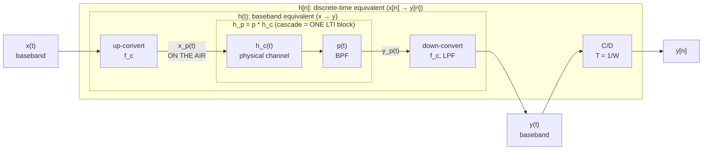

# 03 — Passband ↔ Complex Baseband & the Baseband-Equivalent Channel (Weeks 4–5)

*Sources: BandlimitedSignals (second half), PulseAmpModulation (first half), HW2 Q3, HW3 Q2.*

> 📌 **In homework (⇒ likely important):** **HW2 Q3** (100 m channel: $h_c\to h_p\to h(t)\to h[n]$) and **HW3 Q2** (10-path channel, $f_c=1700$ MHz, $W=20$ MHz). This whole guide is homework-backed — highest priority along with guide 04.

## Why this matters
Every wireless signal is **passband** (energy around a carrier $f_c\gg0$), but all our DSP, modulation, and receiver algorithms live at **complex baseband**. This block is the dictionary between the two. HW2 Q3 and HW3 Q2 are exactly this pipeline: **$h_c(t)\to h_p(t)\to h(t)\to h[n]$**. Expect it on the exam.

## 1. Complex envelope
Any real passband signal can be written
$$x_p(t)=A(t)\cos\big(2\pi f_ct+\phi(t)\big)$$
(information in amplitude and/or phase). Using $\cos(a+b)=\cos a\cos b-\sin a\sin b$:
$$x_p(t)=x_I(t)\cos(2\pi f_ct)-x_Q(t)\sin(2\pi f_ct),\qquad x_I=A\cos\phi,\ x_Q=A\sin\phi$$
**Complex envelope (complex baseband signal):** $x(t)=x_I(t)+jx_Q(t)=A(t)e^{j\phi(t)}$, so
$$\boxed{x_p(t)=\text{Re}\{x(t)e^{j2\pi f_ct}\}}$$
(This is the lecture/HW2 convention — Fig. 14/16 have no $\sqrt2$ on up-conversion and a **×2** after the low-pass filter on down-conversion. Some textbooks use $\sqrt2\,\text{Re}\{\cdot\}$; if you ever see that, the scale factors change but the structure doesn't.)

- **In-phase** $x_I$ rides on $\cos$; **quadrature** $x_Q$ rides on $-\sin$.
- **Spectrum:** $X_p(f)=\tfrac12\big[X(f-f_c)+X^*(-f-f_c)\big]$ — a half-amplitude copy at $+f_c$ and its mirror-conjugate at $-f_c$.

## 2. Up-conversion (baseband → passband)
Multiply $x_I$ by $\cos(2\pi f_ct)$ and $x_Q$ by $-\sin(2\pi f_ct)$ and add. In frequency: shift up, **amplitude ÷2**.
## 3. Down-conversion (passband → baseband)
$$y(t)=\text{LPF}\{2\,y_p(t)\,e^{-j2\pi f_ct}\}$$
i.e. $y_I=\text{LPF}\{2y_p\cos\}$, $y_Q=\text{LPF}\{-2y_p\sin\}$. Using $\cos^2=\tfrac12(1+\cos2\cdot)$ etc., the LPF removes the $2f_c$ terms and the **2** restores the amplitude. **Slide summary: up-conversion divides by 2, down-conversion multiplies by 2.**

*Why the complex envelope is great:* it halves the bandwidth you have to sample ($W/2$ each side instead of $f_c+W/2$), and an LTI **passband** system becomes an LTI **baseband** system (next section).

## 4. Channel models
- **Linear time-varying (LTV):** accurate (mobility, moving reflectors) but hard to design algorithms for. 
- **LTI / "block fading":** assume the channel is constant for a block/packet/frame. Valid when the block is shorter than the **channel coherence time** (typical blocks 0.5–10 ms). **We assume LTI.**

## 5. From the physical channel to the baseband-equivalent channel

Signals are the labels on the arrows; channels are the boxes. `p * h_c` is an impulse response (a block), not an output signal; a signal convolved with a block gives an output signal.

Chain: **physical channel** $h_c(t)$ → **passband channel** $h_p(t)$ → **baseband equivalent** $h(t)$ → **discrete-time** $h[n]$.

**Step 1 — $h_c(t)$ (the LTI model of the propagation).** Typically $h_c(t)=\sum_k a_k\,\delta(t-\tau_k)$ (multipath: gain $a_k$, delay $\tau_k=d_k/c$). Free-space single path: $h_c(t)=\alpha\delta(t-\tau)$, $\tau=d/c$.

**Step 2 — $h_p(t)$.** Only the part of the channel inside the signal's band matters: $h_p(t)=p(t)*h_c(t)$ with $p(t)$ an ideal **bandpass filter** centered at $f_c$, absolute bandwidth $W$:
$$h_p(f)=h_c(f)\,\text{rect}\!\left(\frac{|f|-f_c}{W}\right)\ \ (\text{both }\pm f_c\text{ bands}).$$
If $h_c$ is a pure delay/attenuation with flat magnitude, $h_p=h_c$ (HW2 Q3b) — the filter doesn't change it *within the band*; strictly it band-limits it.

**Step 3 — $h(t)$ (baseband equivalent).** Take the positive-frequency band, shift to DC:
$$\boxed{h(f)=h_p(f+f_c)\ \text{for }|f|\le W/2,\quad 0\text{ elsewhere}}\ \Longleftrightarrow\ h(t)=\text{LPF}\{h_p(t)e^{-j2\pi f_ct}\}$$
**Scaling trap ("slightly different result for the channel"):** signals get the ÷2 / ×2 factors, **the channel does not** — you shift the channel's positive-frequency band without extra factors. (Consistency check: a pure delay $h_p=\alpha\delta(t-\tau)$ gives $y_p=\alpha x_p(t-\tau)$, i.e. $y(t)=\alpha e^{-j2\pi f_c\tau}x(t-\tau)$.) Hence

$$\boxed{h_c(t)=\sum_k a_k\delta(t-\tau_k)\ \Longrightarrow\ h(t)=\sum_k a_k\,e^{-j2\pi f_c\tau_k}\,\delta(t-\tau_k)\ \ (\text{bandlimited to }W/2)}$$

The factor $e^{-j2\pi f_c\tau_k}$ is the **carrier phase rotation** from the delay. Because $f_c$ is GHz, a nanosecond change in delay changes the phase by a lot — only the fractional part of $f_c\tau$ matters (HW2 Q3c: $f_c\tau=666.67$ cycles ⇒ phase $=-240^\circ\equiv+120^\circ$).

**Step 4 — $h[n]$ (discrete-time, sample at Nyquist $T=1/W$).** The complex baseband $h(t)$ is bandlimited to $W/2$, so use the sinc-lowpass-then-sample formula from Block 02:
$$\boxed{h[n]=\int\text{sinc}(\tau W)\,h(nT-\tau)\,d\tau\ \Rightarrow\ h[n]=\sum_k a_k\,e^{-j2\pi f_c\tau_k}\,\text{sinc}\!\left(n-\frac{\tau_k}{T}\right)}$$

## 6. Worked examples

### 📌 HW2 Q3 — $d=100$ m, attenuation 0.1, $W=5$ MHz, $f_c=2$ GHz
- $\tau=100/(3\times10^8)=333.3$ ns. 
- (a) $h_c(t)=0.1\,\delta(t-333.3\text{ ns})$. (b) $h_p=h_c$ (flat). (c) $h(t)=0.1e^{-j2\pi f_c\tau}\delta(t-\tau)=0.1e^{j120^\circ}\delta(t-333.3\text{ ns})$.
- (d) $T=1/W=200$ ns, $\tau/T=1.667$ ⇒ $h[n]=0.1e^{j120^\circ}\text{sinc}(n-1.667)$ — **delay not a multiple of $T$ ⇒ energy leaks into many taps**; dominant tap at $n=2$.

### 📌 HW3 Q2 — $f_c=1700$ MHz, $W=20$ MHz, $h_c(t)=\sum_{k=0}^{9}0.8^k\delta(t-k\cdot10^{-7})$ (my worked check)
- $T=1/W=50$ ns. (a) $h_c(f)=\sum_{k=0}^{9}0.8^ke^{-j2\pi f k10^{-7}}$ (geometric series: $\frac{1-(0.8e^{-j2\pi f10^{-7}})^{10}}{1-0.8e^{-j2\pi f10^{-7}}}$).
- (b) $h_p(f)=h_c(f)$ restricted to $|\,|f|-f_c|\le10$ MHz; in time $h_p(t)=p(t)*h_c(t)$ — each impulse becomes $0.8^k\cdot p(t-k\cdot10^{-7})$ where $p(t)=2W\,\text{sinc}(Wt)\cos(2\pi f_ct)$ (ideal BPF, height scaled so passband gain is 1).
- (c) $h(t)=\sum_k0.8^k e^{-j2\pi f_ck10^{-7}}\,W\text{sinc}(W(t-k10^{-7}))$. Here $f_c\cdot10^{-7}=170$ **cycles (an integer)** ⇒ the phase factor is **1** for every path.
- (d) $\tau_k/T=100\text{ns}/50\text{ns}=2k$ ⇒ every path lands exactly on a sample: $h[n]=\sum_k0.8^k\text{sinc}(n-2k)=\begin{cases}0.8^{n/2}&n\in\{0,2,\dots,18\}\\0&\text{else}\end{cases}$. 
 Nice test of whether the sinc collapses to a delta. (Whether the problem wants the $W\text{sinc}$ or unit-sample form depends on the lecture's scaling; check against the posted solution.)

## 7. Two lookups worth memorizing
- $x_p=\text{Re}\{xe^{j2\pi f_ct}\}$; down: $x=\text{LPF}\{2x_pe^{-j2\pi f_ct}\}$.
- Delay $\tau$ in passband ⇒ baseband gain gets $e^{-j2\pi f_c\tau}$ **and** the envelope is delayed by $\tau$.

## Traps
- Forgetting $e^{-j2\pi f_c\tau}$ in the baseband channel (the phase rotation).
- Applying the ÷2/×2 signal scaling to the *channel*.
- Using $T=1/W$ with $W$ the **total** passband bandwidth (correct: complex baseband rate = $W$, since baseband occupies $[-W/2,W/2]$).
- Reducing $f_c\tau$ mod 1 *before* taking the phase — fine and easier; just keep the sign.

## Self-test
1. Express $x_p(t)$ for $x=1+j$ constant, $f_c$ given. ($=\cos(2\pi f_ct)-\sin(2\pi f_ct)=\sqrt2\cos(2\pi f_ct+\pi/4)$.)
2. Derive down-conversion: show $2\cos^2(2\pi f_ct)=1+\cos(4\pi f_ct)$.
3. Compute $h(t)$ and $h[n]$ for a 2-path channel with $f_c=900$ MHz, $\tau_1=100$ ns, $\tau_2=250$ ns, $W=10$ MHz.
4. Why is block fading a reasonable approximation? (coherence time ≫ packet length.)

## Lab link
In the USRP, the "IQ" you capture **is** the complex baseband signal $y[n]$; the mixer + LPF + ADC are the down-conversion + C/D. Lab 1 Part 2: IQ rate is an integer decimation of 100 MS/s ⇒ it sets $T=1/W$.

